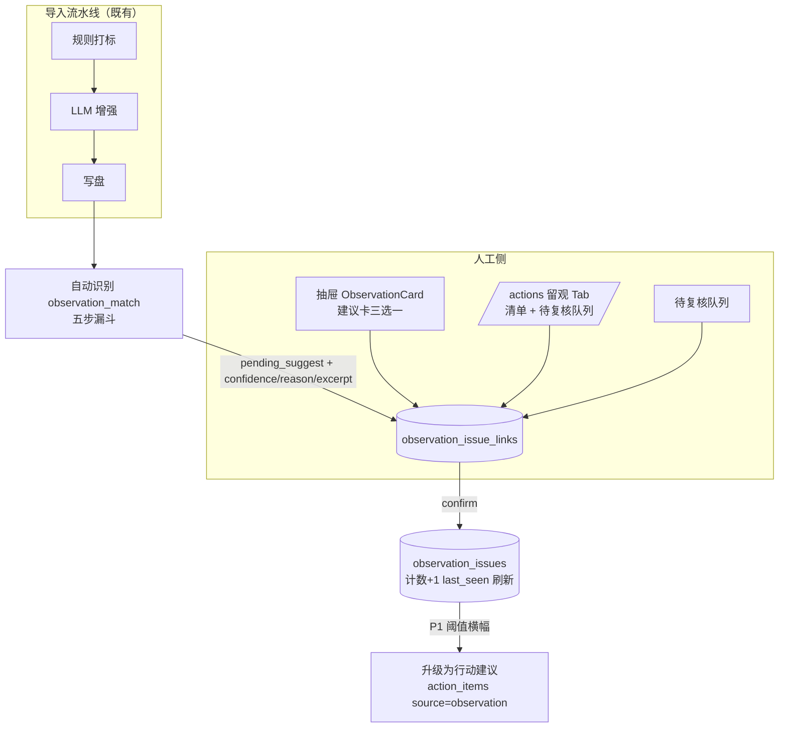

# 设计文档 · 留观问题 @20261031-1

> 状态：详细设计 + 任务索引
> 最后更新：2026-10-31
> **可执行任务清单**：[TASKS-20261031-1.md](./TASKS-20261031-1.md)

---

## 0. 背景与目标

### 0.1 问题域

| 问题域 | 现状 | 目标 |
|--------|------|------|
| 零星问题无处安放 | 未形成典型问题的反馈散落库中，人工口头"纳入观察"无载体 | **留观问题（Observation Issue）** 实体：问题描述 + 出现计数 + 证据链 |
| 二三次出现想不起来 | 人工记忆失效，同类问题重复出现无法识别 | **自动识别**：导入后自动初判是否命中已有留观问题，产出待复核建议 |
| 人工复核无闭环 | 无"是否老问题复现"的复核入口 | 抽屉建议卡 + 清单队列，三选一（确认关联 / 新建留观 / 不纳入） |
| 跨源孤岛 | 工单与用后即评负面反馈互不相认 | 同一 issue 挂跨源证据，锚点 + 语义判别做交叉关联 |

### 0.2 已确认产品决策（对话定稿）

| 主题 | 决策 |
|------|------|
| 负面池口径 | **不看分数**：只看实质 lowScoreReason（占位词/正面词/裸动作词清洗，复用 reasonTaxonomy） |
| 问题描述 | 人工输入，预填拼接（工单=场景+痛点；评价=原因标签+原文摘录），**上限 100 字** |
| 判别语料 | issue 侧=描述（主锚）+代表证据（confirmed 最新滚动）；工单侧=痛点+客户请求，**处理意见不进画像**（已蒸馏进痛点；瘦工单兜底带整段、末段优先截断）；评价侧=原文+原因标签 |
| 语料现值 | 人工修改后即时生效（putRecord 事务内同步 FTS 索引 + manualTagFields 双保险）；已产生 pending 不回溯，重判走显式 scan |
| 抽屉落位 | 「2·工单分析」区内、「会议待办」卡前，独立组件 ObservationCard；工单/评价共用；空态半显（常驻「纳入观察」入口，内容区不渲染） |
| 模块归属 | 并入 `/actions` 第 5 Tab（key=`observation`），模块更名「**问题与举措**」；Tab 先行、路由可升 |
| 清单信息架构 | 清单层统一（不分来源，两小分列显示工单数/评价数）；详情层分源（证据按来源分组）；来源构成筛选 |
| 证据查看 | 两个入口：**展开行**（快速读证据+跳转 drawer）+ **详情侧滑**（编辑问题本体/解除关联/匹配历史） |
| 待复核队列 | pending_suggest 的反向集中视图（按时间倒序批量清账），与抽屉建议卡同数据双视图 |
| 自动识别边界 | **只做已有 issue 的召回判别，不做新问题发现**；新问题永远人工发起 |
| 自动触发 | 导入 enrich 完成后自动触发 + 横幅提示；手动补跑走显式 scan（不自动重跑已判） |

### 0.3 复用资产

| 资产 | 用途 |
|------|------|
| `tag_candidates` 体系 | 候选→pending→人工复核→采纳的闭环形态先例 |
| post_use_journey 后置模式 | 独立 enrich mode + pending-count breakdown 横幅 + 显式重试 |
| `assistantSearchIndex`（FTS5 trigram） | 召回引擎，已索引痛点/客户请求/受理内容/处理意见/评价内容 |
| 用后即评 `originalTicketId` | 锚点通道的强信号 |
| `backgroundTaskLock` + 流式写盘 | 后台任务框架 |
| `action_items.source` | P1 升级出口去向 |
| `reasonTaxonomy.js` 清洗体系 | 负面池入口判定 |

---

## 1. 总体架构

### 1.1 六条核心架构决策

1. **issue 是问题实体**：留观问题 = 聚合主体（描述/计数/状态），工单与评价是挂其下的证据（links）；
2. **关联独立建表，绝不写 record payload**：`putRecords` 为覆写式写盘（导入合并/批量重打标/流式 flush 均整条覆盖），独立表天然免疫冲掉，重打标/导入零感知零回归；
3. **自动识别是打标后置阶段**（enrichRunner 新 mode `observation_match`）：LLM 增强全部完成后跑，画像最完整、不阻塞主链路、可独立重试；
4. **只建议不代判**：产出 pending_suggest + 置信度 + 理由 + 摘录，record 本体零改动；dismissed 留行做否决记忆（同 issue+record 组合不再弹）；
5. **留观动作独立 API**：不进 `buildDraftRecord` 表单保存流、不与 record revision 乐观锁耦合；动作记 audit_log；
6. **Tab 先行、路由可升**：`/actions?tab=observation` 起步，未来膨胀再提为一级路由。

### 1.2 数据流



---

## 2. 数据模型

businessDb.js 幂等迁移，两表 + 索引：

```sql
CREATE TABLE IF NOT EXISTS observation_issues (
  id TEXT PRIMARY KEY,
  product_key TEXT NOT NULL DEFAULT '',
  product_name TEXT NOT NULL DEFAULT '',
  status TEXT NOT NULL DEFAULT 'watching',      -- watching | promoted | archived
  title TEXT NOT NULL DEFAULT '',
  summary TEXT NOT NULL DEFAULT '',             -- 问题描述 ≤100 字
  occurrence_count INTEGER NOT NULL DEFAULT 0,  -- 冗余；links 为真源
  first_seen_at TEXT NOT NULL DEFAULT '',
  last_seen_at TEXT NOT NULL DEFAULT '',
  payload TEXT NOT NULL DEFAULT '{}',           -- keywords/notes/promotedTo
  created_by TEXT NOT NULL DEFAULT '',
  created_at TEXT NOT NULL DEFAULT ''
);
CREATE INDEX IF NOT EXISTS idx_obs_issues_product ON observation_issues(product_key);
CREATE INDEX IF NOT EXISTS idx_obs_issues_status ON observation_issues(status);

CREATE TABLE IF NOT EXISTS observation_issue_links (
  id TEXT PRIMARY KEY,
  issue_id TEXT NOT NULL,
  record_id TEXT NOT NULL,
  record_data_source TEXT NOT NULL DEFAULT '',  -- complaint_ticket | consultation_ticket | post_use_rating
  ticket_id TEXT NOT NULL DEFAULT '',
  link_status TEXT NOT NULL DEFAULT 'confirmed',   -- confirmed | pending_suggest | dismissed
  link_source TEXT NOT NULL DEFAULT 'manual',      -- manual | auto_match | auto_anchor
  match_confidence TEXT NOT NULL DEFAULT '',       -- high | medium | low（仅建议）
  match_reason TEXT NOT NULL DEFAULT '',
  matched_excerpt TEXT NOT NULL DEFAULT '',
  proposed_at TEXT NOT NULL DEFAULT '',
  reviewed_by TEXT NOT NULL DEFAULT '',
  reviewed_at TEXT NOT NULL DEFAULT '',
  created_at TEXT NOT NULL DEFAULT '',
  UNIQUE(issue_id, record_id)
);
CREATE INDEX IF NOT EXISTS idx_obs_links_issue ON observation_issue_links(issue_id);
CREATE INDEX IF NOT EXISTS idx_obs_links_record ON observation_issue_links(record_id);
CREATE INDEX IF NOT EXISTS idx_obs_links_status ON observation_issue_links(link_status);
```

要点：
- 计数/首末次出现为冗余列，confirmed 变更时**同一事务内**由 repository 重算刷新；
- `dismissed` 不删除——"这个组合人工已否"的记忆，防重复弹；
- issue 无"来源"字段：产品问题不分家，来源只存在于 links 层。

---

## 3. 判别引擎（五步漏斗）

### 3.1 五步定义

| 步 | 名称 | 依据 | 口径 |
|----|------|------|------|
| 1 | 对象筛选 | 负面判定 + 产品边界 | 投诉/咨询工单全量；评价 = 实质 lowScoreReason（FEEDBACK_REASON_PLACEHOLDERS / POSITIVE_FEEDBACK_REASONS / NEGATED_POSITIVE_RE / BARE_ACTION_WORDS 清洗），**不看分数**；产品命中目录（resolvePostUseRatingProduct），目录外不进自动池（手动纳入不受限） |
| 2 | 召回 | 同产品三通道 | ①FTS trigram 证据语料（confirmed links 对应记录的痛点/客户请求/受理内容/处理意见整字段/评价原文）②issue keywords 通道 ③锚点通道：评价 originalTicketId 命中 issue 已挂工单 → 高置信候选 |
| 3 | 判别 | LLM 逐对 | issue 画像 = summary（主锚）+ 代表证据（最新 confirmed 的痛点/原文）；工单画像 = painPoint + customerRequest（瘦工单兜底：处理意见整段带角色标签、末段优先、字符上限截断）；评价画像 = 原文 + 原因标签；输出 `{decision: same|not_same, confidence, reason}`；**same 且 medium 以上才出建议**；LLM 不可用 → 降级字面+标签分（不出 high） |
| 4 | 落建议 | 只写 link 表 | pending_suggest + confidence/reason/excerpt；已 dismissed 的 (issue, record) 组合跳过；`UNIQUE(issue_id, record_id)` 冲突时静默跳过 |
| 5 | 人工三选一 | 建议卡证据链 | 确认关联（confirmed + 计数+1）/ 新建留观（原建议转 dismissed-superseded）/ 不纳入（dismissed） |

### 3.2 疑似关联判定依据（落 pending_suggest 的充要条件）

一条新记录要成为"疑似命中留观问题 X"的建议，**必须同时满足以下五个条件**（缺一即不产生建议，安静留在库中）：

| # | 条件 | 判什么 | 依据来源 |
|---|------|--------|----------|
| C1 | 候选池资格 | 记录本身值得参与匹配 | 工单全量；评价 = 实质 lowScoreReason（清洗规则）；产品命中目录 |
| C2 | 召回命中 | 同产品下至少一个通道召回到 issue X | FTS 字面 / keywords / 锚点（三通道任一） |
| C3 | 语义判别通过 | X 的画像与本记录画像"是同一产品问题" | **锚点命中 → 直接通过（high）**；否则 LLM 判 `same` 且 `confidence ≥ medium`；降级模式下字面/标签评分达 medium 线 |
| C4 | 非重复非否决 | (issue X, 本记录) 无既有行 | confirmed（已关联）/ pending_suggest（已在队列）/ dismissed（人工已否决）均跳过 |
| C5 | issue 处于观察态 | X 还在产出建议 | status = watching（promoted / archived 不再产建议） |

**置信度语义**（写进 match_confidence 列，供复核排序与后续调门槛）：
- `high`：锚点通道命中（评价的 originalTicketId 指向已确认挂在该 issue 的工单——原工单已被人工确认属于此问题，其衍生评价视为强信号，**跳过 LLM、零成本**）；或 LLM 判 same 且 high；
- `medium`：LLM 判 same 且 medium（字面可能零重叠，语义对照成立——同义语识别的主战场）；
- `low`：LLM 判 same 但 confidence=low → **不出建议**（宁漏勿错：一次假阳成本是人工 30 秒否决，一次假阴才是回到原始痛点）。

**降级模式（LLM 不可用）**：字面重叠评分（trigram 重叠词数 + keywords 命中数 + 原因标签相同）达 medium 线才出建议，且**永不产 high**——机器把握不足时只给保守建议。

> **C4 的人工例外**：跳过规则只约束**自动**建议的产出；人工不受限——可在无任何建议时直接关联（`link_source=manual`），也可把早前 dismissed 的组合重新挂为 confirmed（人工推翻自己的否决，见 §4.1 upsert 优先级矩阵与 §5.4 人工兜底路径）。

#### 示例（正反对照）

设 A 产品有留观 issue X「退订入口难找」（summary："控制台找不到退订/取消入口，列表超 50 条翻不到"）。

| 例 | 新记录 | 五步走向 | 结果 |
|----|--------|----------|------|
| ① 同义命中 | 工单 #205：痛点「共享带宽无法取消」、请求「想退订退不掉」 | C1✓；C2✓（FTS 召回"退订"字面）；C3✓（LLM：same/medium，理由"两者均为退订操作入口受阻"）；C4✓；C5✓ | **出建议（medium）**，excerpt 记痛点原文 |
| ② 锚点直接命中 | 评价「折腾半天没搞定」，originalTicketId=#101（#101 已确认挂在 X） | C1✓；C2✓（锚点通道）；C3✓（锚点直通，跳过 LLM） | **出建议（high）**，理由"原工单 #101 已确认属于此问题" |
| ③ 字面撞车但语义不符 | 工单 #207：痛点「控制台提示语看不懂」 | C1✓；C2✓（"控制台"字面召回 X）；C3✗（LLM：not_same——一个是入口找不到，一个是文案可读性） | **不出建议**，无任何落库 |
| ④ 语义像但把握低 | 评价「不太好用」 | C1✓；C2✓（keywords 通道）；C3 半（LLM：same/low） | **不出建议**（low 门槛拦截） |
| ⑤ 否决记忆 | 例①的工单 #205 下次再被扫描 | C4✗（已有 dismissed/已处理行） | 不再弹（UNIQUE + 状态过滤） |
| ⑥ 跨产品不比 | B 产品工单痛点「退订失败」 | C2✗（召回仅同 product_key 内） | 不出建议（跨产品为 P1 开关） |

例②值得注意的设计含义：**锚点通道同时是"交叉关联"的第一批供给**——评价经工单锚点挂上以工单证据为主的 issue，混合 issue 自动形成，无需语义判别参与。

### 3.3 判别 prompt 形态（strict 选一）

- 系统角色 + 规则：只选不造、输出 JSON、必附 confidence 与 reason；
- 对照材料分「留观问题」与「新反馈」两栏，各自带角色标签；
- 对齐 journeySemantic 的 strict 输出哲学；解析失败按 not_same 处理（宁漏勿错）。

### 3.4 语料现值保证

- putRecord 事务内 `upsertRecordIndex` 已同步 FTS 索引 → 人工修改即时生效；
- manualTagFields + preserveManualTags 双保险防重打标冲回；
- matched_excerpt 是判别当时快照，不回溯改写（历史证据链保真）；
- 改描述 → 即时影响后续判别；已产生 pending 不回溯，重判走显式 scan。

### 3.5 同义语识别三层（评价侧）

| 层 | 机制 | 角色 |
|----|------|------|
| 字面重叠 | trigram 子串召回 | 省钱收窄候选，只产生候选不做终判 |
| 标签归一 | 固定原因清单（控制台 18 项/回访 6 项）同标签聚合 | 免算 LLM |
| LLM 语义判别 | 措辞零重叠的自由文本 | **主力**：中文负面措辞散度高（卡/慢/打不开/转圈），恰恰是零星痛点区 |

---

### 3.6 跨源语义交叉通道（补射）

判别引擎第 3 步的**补射通道**，非并列重跑：

- **触发条件**：同源判别完成且无命中（全 not_same）才跑——增量 LLM 成本只花在"字面/同源都漏掉"的子集；
- **判别差异**：issue 画像带证据类型说明（工单=书面语 / 评价=口语化），prompt 显式语域对齐："评价口语化、工单书面化，判断是否同一底层产品问题，忽略语言风格差异"；
- **置信度封顶 medium**：跨源语义把握天然低一档，永不产 high；match_reason 加「跨源」前缀；
- 落库照旧 pending_suggest，与其他建议同队列同三选一。

## 4. 后端设计

### 4.1 repository

`server/observationRepository.js`（照 userTicketReviewRepository 模式）：

- `listIssues(filters)` / `getIssue(id)` / `putIssue(issue)` / `updateIssue(id, patch)`；
- `listLinksByIssue(issueId)` / `listLinksByRecord(recordId)`（含 pending 建议）/ `putLink(link)` / `deleteLink(id)`；
- `listPendingSuggestions({page, filters})`：pending_suggest 倒序，联 issue 标题与记录摘要（记录按 id 批量取，**先过滤后分页**）；
- `reviewSuggestion(linkId, action, actor)`：事务内改 link_status、刷新 issue 冗余列；
- `pendingCount()`：`{total, high, medium, low}` breakdown；
- 计数重算：`refreshIssueAggregates(issueId)` 事务内 `COUNT(*) GROUP BY link_status, record_data_source`。

### 4.2 路由（`server/routes/observation.js`）

| Method | Path | 权限 | 说明 |
|--------|------|------|------|
| GET | `/api/observation/issues` | view | 清单（分页/筛选：产品、状态、来源构成） |
| POST | `/api/observation/issues` | editRecord | 新建（含首条 link 可选） |
| GET | `/api/observation/issues/:id` | view | 详情（本体+links 分组+匹配历史含 dismissed） |
| PATCH | `/api/observation/issues/:id` | editRecord | 编辑标题/描述/keywords/备注/状态 |
| POST | `/api/observation/issues/:id/links` | editRecord | 手动挂证据（confirmed，含 S3 推翻 dismissed：body 带 `overrideDismissed=true` 时确认提示前端已做） |
| DELETE | `/api/observation/issues/:id/links/:linkId` | editRecord | 解除关联（级联刷新计数） |
| GET | `/api/observation/records/:recordId/search` | view | 人工兜底用：按 ticket_id / 评价关键字搜可挂记录（同产品优先，返回摘要+是否已挂其他 issue） |
| GET | `/api/observation/matches/pending-count` | view | 横幅 breakdown |
| GET | `/api/observation/matches` | view | 待复核队列（分页倒序） |
| POST | `/api/observation/matches/:linkId/review` | editRecord | `{action: confirm\|dismiss\|new_issue}` |
| POST | `/api/observation/scan` | import | 手动触发批量识别（后台任务） |
| POST | `/api/observation/issues/:id/promote` | editRecord | F2 升级：预填建 action_items（source='observation'，pending_evaluation）+ issue 转 promoted；已 promoted 返回 409 |
| DELETE | `/api/observation/issues/:id` | editRecord | 删除（Popconfirm + links 级联清理） |

全部写操作记 audit_log；schema 走 `server/schemas/observationSchemas.js`。

### 4.3 enrichRunner mode `observation_match`

- 触发：导入 enrich 完成后自动（import 流程尾部追加）+ 手动 `POST /scan`（对指定月份/批次补跑）；
- 输入：该批新写入 records + 候选池过滤（3.1 步 1）；
- 执行：三通道召回 →（LLM 可用时）逐对判别 → 写 pending_suggest；
- 框架复用：backgroundTaskLock / touch 进度 / isTaskCancelled 协作取消 / 分批 yield；
- 失败隔离：单条判别异常捕获记 warnings，不中断整批；LLM 整体不可用 → 降级路径 + 横幅标注"降级"。

### 4.4 模块更名

AppShell `ALL_NAV`：`/actions` label「举措与进展」→「**问题与举措**」。

---

## 5. 前端设计

### 5.1 抽屉 ObservationCard

- 位置：「2·工单分析/评价分析」区内、「会议待办」卡前（FeedbackDrawer.jsx L2267 前插入一行渲染）；
- 组件：`src/components/observation/ObservationCard.jsx` 独立文件（防 2853 行的 FeedbackDrawer 继续膨胀）；
- 内容：疑似命中建议卡（amber：问题名+置信度徽标+理由一行+两段对照+三选一按钮；多条堆叠）+ 已关联列表（问题名跳清单/出现次数/最近时间/[查看][解除]）+ 右上「纳入观察」；
- 空态（无建议无关联）**不整卡隐藏**：保留标题行 + 常驻「纳入观察」入口（人工兜底 S1/S2 的主路径），内容区不渲染——空态半显（区别于 hasDetailOptimizationContent 的整卡隐藏：留观卡承载人工主动动作，不可藏到找不到）；
- 动作独立 API 即时执行，本地状态置 done 即消失；建议处理完不重拉抽屉；
- 纳入 Modal 预填：工单 = `请求场景 + 痛点`（兜底客户请求节选→处理意见首句）；评价 = `原因标签 + 原文摘录`（原因为"其他"只用摘录）；从建议卡新建 = 被判中痛点；描述上限 100 字 showCount。

### 5.2 /actions 第 5 Tab

- key=`observation`，label「留观问题」，插在「问题压降」与「Playbook 沉淀」之间；
- 组件：`src/pages/observation/ObservationTab.jsx` + 队列/清单子组件（目录式组织，对齐 TicketTodoTab 惯例）；
- 上段清单：主表列 = 产品 / 问题标题 / 出现次数（总）/ 工单数 / 评价数 / 最近出现 / 状态 / 操作；筛选 = 产品、状态、来源构成（全部/含工单证据/仅评价证据）；行操作 = 详情/编辑/归档/删除；
- 下段待复核队列：时间倒序，行 = 建议关联 issue · 来自记录摘要 · 置信度 · 理由摘要 · [处理]（轻量复核弹窗：两段对照 + 三选一）· 工单号跳 drawer；
- 展开行：问题描述一行 + 证据两小节（工单证据 N / 评价证据 N，每条时间+摘要+跳 drawer）+ pending 就地三选一；
- 详情侧滑：问题本体（可编辑）+ 证据总表（可解除关联）+ 匹配历史（含 dismissed 审计）；升级阈值横幅为 P1；
- tab 路由参数 `?tab=observation`，与现有 4 tab 的 URLSearchParams 模式一致。

- **F1 升级阈值横幅**：行/展开行/侧滑三处「建议升级」amber 徽标（occurrence_count ≥ 阈值，默认 3，AppSettings `observationPromotionThreshold` 可配）；**F2 升级按钮**：Popconfirm 确认 → 调 promote API → 提示成功并跳 `/actions?tab=product`；已 promoted 显示「已升级 → 跳举措」；**F3 keywords 建议 chips**：编辑侧滑/新建 Modal 的 keywords 输入旁出「建议」chips，人工逐个点击采纳（n-gram 本地候选，LLM 可用时增强），不自动写库。
- **F4 清单导出 CSV**：Tab 工具栏「导出」按钮（当前筛选/全部两档，对齐举措导出 scope 模式）；客户端生成（无新路由）：\ufeff BOM 保 Excel 中文、RFC 转义、列含证据明细（cap 5000 行）；builder 纯函数可单测。

### 5.3 导入完成横幅

- 复用 post-use-journey 横幅模式：「本次导入 N 条疑似命中留观问题，待复核」+ confidence breakdown {high, medium}；降级模式标注「降级（字面判别）」；
- 点击跳 `/actions?tab=observation` 队列段。

### 5.4 人工兜底路径（两个漏检场景）

自动识别漏掉、但人工复核后认定归属的两种情况，三条入口均可达成：| 场景 | 操作路径（三入口任选） | 数据效果 |
|------|------------------------|----------|
| S1 · 应关联已有 | **抽屉卡**：无建议显示时点「纳入观察」→ Modal 切「关联已有」→ 搜同产品 issue 确认；**问题侧**：清单/侧滑展开「+ 添加证据」→ 按 ticket_id / 评价关键字搜索记录挂上（不产生 pending，直接 confirmed） | 该 issue 计数 +1、last_seen 刷新、代表证据滚动更新 |
| S2 · 应新建留观 | 同一「纳入观察」Modal 切「新建」，预填规则不变（场景+痛点 / 原因标签+原文摘录） | 新 issue 创建，本记录为第一条 confirmed 证据 |
| S3 · 推翻旧否决 | 问题侧「+ 添加证据」选中曾被 dismissed 的记录 → 确认时明确提示"此组合此前被否决，确认后将转为已确认" | dismissed 行升级为 confirmed（link_source 转人工、confidence/reason 清空重记） |

三入口与组件的对应：**抽屉卡入口**（S1/S2）= ObservationCard 右上「纳入观察」+ ObservationAttachModal；**队列入口**（S1/S2/S3）= 队列"关联到其他 issue"链接；**问题侧入口**（S1/S3）= 清单展开行与详情侧滑的「+ 添加证据」按钮（**本节新增，前文清单操作列需含此项**）。

**兜底不触发重扫**：S1-S3 均为一次性人工写库，不改自动识别的已判记忆（除 S3 显式推翻）；后续 scan 因 C4 看到该组合已是 confirmed 而跳过，不会重复弹建议。

### 5.5 会议待办转留观（入口扩展）

会议待办是"零星问题第一次出现"的高频现场——处理路径除「确立举措/无举措」外新增「转留观」，让不够格立举措的待办进入观察体系：

- **数据模型**：`TicketTodoResolution` 加 `converted_to_observation`（已转留观）；`TicketTodoItem` 加 `linkedObservationIssueId`（与 linkedActionId 对称，走 buildTicketTodoSavePatch 同通道）；
- **处理弹窗**：第三个单选项「转留观」→ 内嵌复用 ObservationAttachModal，预填 summary=待办文本（截 100 字）、产品=宿主工单产品、首条证据=宿主工单记录（confirmed）；可切「关联已有」；确认后 resolution 终态 + 回链 issue id；
- **操作栏快捷入口**：删除按钮旁「转留观」图标（EyeOutlined）直接开预填 Modal；宿主记录缺失时禁用+tooltip（对齐"未找到关联工单"守卫）；
- **终态语义**：已转留观不回 open；issue 日后 promote 成举措时待办保持已转留观（升级在 issue 侧追踪，linkedObservationIssueId 跳转）；
- **统计**：状态卡加「已转留观」块；**转化率分别统计**——转举措率 = 已转举措/总数、转留观率 = 已转留观/总数，两个独立指标块并列展示（不合并计率）；TicketTodoStatusTag/分产品图/常量表补新态（teal 色）；
- **服务端**：ticketTodos stats 聚合加新态（纯加法）。

---

## 6. 风险对照（已知坑逐一规避）


| 已知坑 | 规避 |
|--------|------|
| putRecords 覆写冲掉 record 字段 | 关联独立建表，天然免疫 |
| 服务端目录/索引缓存易陈旧（getCatalogProducts 前科） | 匹配器读 issue/links 直查库；目录消费前刷新（照 refreshProductCatalogForReminder 模式）；FTS 索引随 putRecord 事务刷新 |
| 用后即评产品边界 | 对齐 resolvePostUseRatingProduct：目录内才参与自动匹配 |
| fieldRegistry/导出/manualTagFields 零污染 | 留观不进任何既有字段体系；清单单独导出（P2） |
| 分页错误（DB 分页+内存过滤） | 队列/清单先过滤后分页 |
| FeedbackDrawer 膨胀 | ObservationCard 独立组件文件 |
| LLM 判别噪声 | medium 门槛 + strict prompt + reason/excerpt 落库可审计；门槛后续可按复核数据调 |
| 测试 | vitest 受影响子集；tmp config 从 e51ddce 恢复；路由级测试先设 AUTH_DATABASE_PATH 再动态 import |

---

## 7. 分期

- **P0**：两表 + repository + 全 API + schema/审计；ObservationCard + 纳入 Modal；第 5 Tab（清单+队列+两入口）；判别引擎 v1（三通道召回 + LLM 判别 + 降级）；导入自动触发 + 横幅；模块更名。
- **P1（Phase O5，~7d，已设计**见 §5.2 F1-F4 与 §3.6**）**：F1 升级阈值横幅；F2 promote 落 action_items（source='observation'，POST /issues/:id/promote，预填 confirmed 证据与工单号，pending_evaluation 待评估）；F3 keywords 自动建议（n-gram 本地 + LLM 增强，chips 人工采纳）；F5 跨源语义交叉通道（补射、封顶 medium）。
- **P2（保留）**：月报集成；跨产品召回开关；置信度门槛可配（settings）。
- **已从 P2 提前到 O5**：原 P2 的清单导出 CSV（F4）——按用户 2026-10-31 15:06 指令全部纳入实现范围。

详细任务分解见 **[TASKS-20261031-1.md](./TASKS-20261031-1.md)**。
