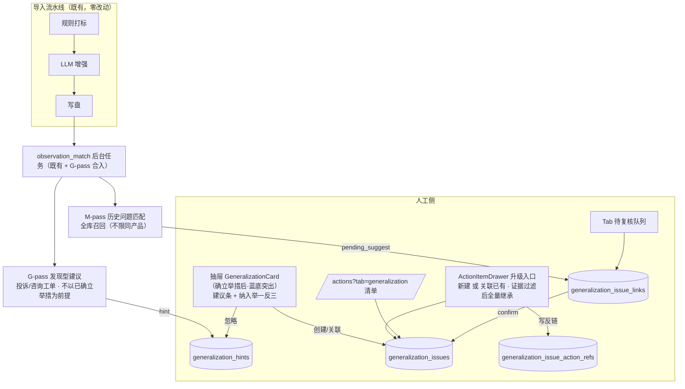

# 设计文档 · 投诉/咨询工单问题举一反三 @20261102-1

> 状态：方案设计 v3.4（**未改任何代码**；批判审视 22 条，修复 11 条缺陷）
> 最后更新：2026-11-03 00:13（v3.4 同步修正：G0-7 合入口径、G1-5 验收防重措辞、G0/G1 估时与总计 19 人日——与 TASKS-20261102-1 对齐）
> v3 变更（用户 12:59 拍板概念模型）：**举一反三与留观不是一个模块**。三轨制：留观=等、举措=治、举一反三=推。
> v3.1（13:09）：举措 → 升级举一反三通路（新建、独立修改、双向跳转、证据全量继承）。
> v3.2（22:03）：抽屉插入点=确立举措后；M-pass 全库召回；删除反向 promote/待办转举一反三/聚类联动；状态机 in_progress/completed/terminated；升级支持关联已有。
> v3.3（23:00 批判审视修复）：**①修复 origin 单列 → `generalization_issue_action_refs` 中间表支持多对一反查；②纠正 matcher 策略："拷贝+prompt 替换"（不能直接 import——留观 matcher 函数名/门函数全部写死）；③from-action 证据挂载加 dataSourceType 过滤（只取投诉/咨询）；④G-pass 合入 observation_match 同一后台任务（避免两轮串行抢锁）；⑤新建前 FTS 去重提示；⑥hint 加 promptVersion；⑦证据列补 match_reason UI；⑧keywords 保存时极短/极通用警告（实现层）；⑨举一反三卡视觉突出（最末卡低可见性补偿）；⑩导入横幅合并为一条"问题识别结果"；⑪关闭弹窗加备注（不强制）。**
> v3.4（23:37 新增需求 + 23:39/23:46 修正）：**举一反三问题增加「根因分析」「优化方案」两字段**——建模为列；列表（问题与举措 · 举一反三 Tab）展示两列；**值只在 Tab 侧滑编辑**（工单抽屉**只读展示**、不提供编辑）；**创建时允许空**，Tab 编辑保存时必填（前端非空校验 + 后端 PATCH 显式传空 400 拒绝，防清空绕过）；**举措升级预填（23:39 修正）**：仅**优化方案 ← 举措内容 content**（预填后可改可清空）；**根因分析不预填**（升级后到 Tab 补全）；CSV 导出补两列。**（23:46 拍板）内部标识符定案：沿用 `generalization`**——方案无剩余待拍板项。

---

## 0. 背景与对齐

### 0.1 需求复述（大白话）

投诉/咨询工单里有一类"值得举一反三"的问题——**场景或出错原因有共性（不是单产品特例）**，且**原因可介入**（编码逻辑不当 / 特殊场景失效 / 控制台操作繁琐 / API 文档错误 / 业务规则设计不当）。要做的三件事：

| # | 需求 | 层级 |
|---|------|------|
| R1 | 工单上能**人工标记**"是否需要举一反三"（基础）；系统能就此**给出建议**（预期，建议≠代判） | 工单级 |
| R2 | 新工单自动识别**是否属于历史举一反三问题**（复发/同类检测） | 问题库级 |
| R3 | 能看到**举一反三问题清单**，能**回看关联的问题情况**（证据链） | 问题库级 |

### 0.2 概念模型（用户 2026-11-02 12:59 定稿 + 13:09 / 22:03 增补）

> 一个工单中暴露的问题：
> - 如果有一定的处理必要但是又不紧迫当下暂不处理，一般可以作为**留观**；
> - 如果当下就要处理，那就回**确立举措**，进一步地如果这个问题有一定共性，那就要考虑是否需要**纳入举一反三**；
> - 留观在一段时间后也可以**升级为举措**
> - 会议待办 可以 **转为留观、举措**。
>
> 原需求中，自动识别是否纳入举一反三 **不以"是否确立了举措"为前提**，因为只是一个建议，不是结果。
>
> （13:09 增补）**举措可以升级举一反三**：升级后新建了一个举一反三，不影响当前举措，两边的修改相互独立，但是可关联跳转。（22:03 增补）升级也允许**手动关联已有举一反三**。
>
> （22:03 批复）举一反三**没有下游出口**；与痛点聚类 V2 完全独立。

转化为模型（**三轨并列；举措 → 举一反三单向升级 + 双向跳转；举一反三无下游**）：

```
工单暴露的问题
  ├─ 留观（observation，已有）：不紧迫，先观察 → 复发计数达阈值 → promote 升级举措（已有）
  ├─ 确立举措（action_items，已有）：当下处理
  │     └─ 问题有共性 → 升级举一反三：新建 gen issue 或关联已有 · 举措零改动 · 双向跳转 · 证据全量继承
  └─ 举一反三（generalization，本方案新建）：
       - 共性问题范畴实体（场景/出错原因有共性 + 原因可介入）
       - 人工发起：从工单纳入（新建/关联已有）· 从举措升级（新建/关联已有）
       - AI 建议（G-pass）：不以已确立举措为前提，任何投诉/咨询工单皆可建议
       - 自动识别（M-pass）：新工单 → 匹配历史举一反三问题 → 待复核（不限同产品）
       - 清单 + 关联工单回看（证据链）
       - 状态机：进行中 → 已完成 / 未完成终止（终态，无下游出口）
```

### 0.3 现状事实锚点（模式蓝本，均已核实）

| 事实（留观体系） | 位置 | v3 复用方式 |
|------|------|-------------|
| 两表模式（issues+links） | `server/businessDb.js` L687-724 | 抄结构建 gen 两表 + 中间表 |
| repository 模式（先聚合后分页、事务重算） | `server/observationRepository.js` | 抄新 generalizationRepository |
| 五步漏斗执行器（CHUNK=4、降级不出 high） | `server/observationScanRunner.js` | **G-pass 合入 observation_match 任务、共用 LLM transport** |
| 召回/判别逻辑（三通道、LLM 逐对） | `src/lib/observation/recall.js` / `matcher.js` | **拷贝到 `src/lib/generalization/` → 替换 prompt 为举一反三版（不能直接 import——函数名/提示语/门函数全写死"留观"）** |
| promote 模式（1:1 新建 action） | `server/routes/observation.js` L288-380 | 升级入口（新建+关联已有）使用**独立中间表** `generalization_issue_action_refs`（多对一） |
| 举措携带证据（linkedTicketIds / evidenceRecordIds） | `src/pages/Actions.jsx` L1074 | 升级时**过滤 dataSourceType**（只取 complaint/consultation）后全量挂 confirmed |
| 导入尾部自动触发 | `server/routes/storage.js` L786-789 | G-pass 合入 observation_match 后台任务（避免两轮 scan 串行抢锁 → 尾部耗时翻倍） |
| 抽屉卡模式 | `src/components/observation/ObservationCard.jsx` | 抄新 GeneralizationCard（**确立举措卡后最末位，淡蓝底色突出**） |
| Tab 模式 | `src/pages/observation/ObservationTab.jsx` 等 | 抄新 src/pages/generalization/ |
| 轻量 KV 表先例 | `server/businessDb.js` L601-604 | gen_hints 表（**加 promptVersion 字段**） |
| 分类判据真源口径：处理意见 = `split('处理意见：')[-1]` | 项目记忆 | G-pass 语料 |

### 0.4 假设与"不做"边界

- **不动留观、不动举措、不动打标闸门与行动建议 run-loop**：举一反三是新增独立模块；**升级通路的举措侧零字段变更**；
- **G-pass 范围 = 投诉/咨询工单**，不以是否确立举措为前提；用后即评不参与；
- **举一反三无下游出口**：不做 gen → 排查举措 promote；不做会议待办转举一反三；
- **只建议不代判**；**新问题永远人工发起**；
- **不写 record payload**（留观铁律延续）；
- **痛点聚类 V2 完全独立**（核实仍在使用）。

### 0.5 命名说明

举一反三 = 从一例推广到同类问题，"推广/泛化"是 generalization 的本义。**代码标识符用英文，用户可见文案全用中文「举一反三」**。

---

## 1. 总体架构

### 1.1 核心架构决策（v3.3）

1. **独立模块**
2. **同模式复用**：抄新文件不抽基类
3. **引擎拷贝（非直接 import）**：recall/matcher 各自拷贝到 `src/lib/generalization/` 后替换 prompt 为举一反三版——留观 matcher 的函数名/提示语/门函数全写死"留观"，直接 import 会污染已上线的 observation 管线
4. **G-pass 合入 observation_match 后台任务**：共用同一个 `backgroundTaskLock` 内的 LLM transport——避免两个 scan 任务各自抢锁串行 → 导入尾部耗时翻倍
5. **AI 建议独立 hint 表**：不进 record payload
6. **"标记 = 确认关联"派生**
7. **升级通路单向 + 多对一反查中间表（v3.3 修复起源单列缺陷）**：`generalization_issue_action_refs` 支持多举措关联同一举一反三问题；origin 反链只存 gen 侧；举措侧零写入；两边互不传播

### 1.2 数据流



---

## 2. 数据模型（四张新表，businessDb.js 幂等迁移）

### 2.1 举一反三问题实体 + 举措反链中间表

```sql
CREATE TABLE IF NOT EXISTS generalization_issues (
  id TEXT PRIMARY KEY,
  product_key TEXT NOT NULL DEFAULT '',
  product_name TEXT NOT NULL DEFAULT '',
  status TEXT NOT NULL DEFAULT 'in_progress'
    CHECK(status IN ('in_progress', 'completed', 'terminated')),
  title TEXT NOT NULL DEFAULT '',
  summary TEXT NOT NULL DEFAULT '',
  category TEXT NOT NULL DEFAULT '',
  scope TEXT NOT NULL DEFAULT '',
  root_cause TEXT NOT NULL DEFAULT '',           -- 根因分析（v3.4；创建可空，Tab 编辑必填）
  optimization TEXT NOT NULL DEFAULT '',          -- 优化方案（v3.4；创建可空，Tab 编辑必填）
  origin_action_id TEXT NOT NULL DEFAULT '',     -- 首个创建它的举措（单值），仅用于视觉回链
  occurrence_count INTEGER NOT NULL DEFAULT 0,
  first_seen_at TEXT NOT NULL DEFAULT '',
  last_seen_at TEXT NOT NULL DEFAULT '',
  payload TEXT NOT NULL DEFAULT '{}',
  created_by TEXT NOT NULL DEFAULT '',
  created_at TEXT NOT NULL DEFAULT ''
);
CREATE INDEX IF NOT EXISTS idx_gen_issues_product ON generalization_issues(product_key);
CREATE INDEX IF NOT EXISTS idx_gen_issues_status ON generalization_issues(status);
CREATE INDEX IF NOT EXISTS idx_gen_issues_category ON generalization_issues(category);
CREATE INDEX IF NOT EXISTS idx_gen_issues_last_seen ON generalization_issues(last_seen_at DESC);

-- 举措↔举一反三 多对一中间表（v3.3 修复 origin 单列缺陷）
CREATE TABLE IF NOT EXISTS generalization_issue_action_refs (
  issue_id TEXT NOT NULL,
  action_item_id TEXT NOT NULL,
  kind TEXT NOT NULL CHECK(kind IN ('created', 'linked')),
  created_at TEXT NOT NULL,
  PRIMARY KEY (issue_id, action_item_id)
);
CREATE INDEX IF NOT EXISTS idx_gen_action_refs_action ON generalization_issue_action_refs(action_item_id);
```

- **root_cause / optimization（v3.4 填充规则，23:46 定稿）**：建模为列（可筛选可导出）；**创建时（各入口：抽屉纳入/举措升级/建议采纳 Modal）允许空**；**唯一编辑入口 = Tab（问题与举措 · 举一反三）详情侧滑**——编辑保存时两字段**必填**（前端非空校验 + 后端 PATCH 显式传空值返回 400，防"先填后清空"绕过）；**工单抽屉的举一反三卡只读展示**：已关联列表中显示两字段值（截断 + tooltip），不提供编辑入口；**升级预填**：仅 optimization ← 举措内容；root_cause 不预填（留待人工分析）；
- **origin_action_id** 保留但仅作"首创建记录"，不参与反向跳转；多对一反查全部走中间表 `generalization_issue_action_refs(action_item_id)`；
- **状态机**："进行中"参与匹配；"已完成"排查闭环、数据保留可查；"未完成终止"中途放弃、数据保留可查；两个终态不再参与自动匹配；
- keywords 存 payload；保存时若极短（<2 字）或极通用（如"报错"）→ 前端轻提示，不强制。

### 2.2 证据链 + 建议 hint 表

结构照 observation 逐列抄（link_status 三态 / link_source / match_confidence / match_reason / matched_excerpt / UNIQUE(issue_id, record_id)），语义原样继承。

hint 表 payload 加 `promptVersion` 字段（string 常量）供未来 prompt 升级时比对——旧 pending hint 的版本落后可选择性重判。

### 2.3 可介入原因范畴枚举

| key | label |
|-----|-------|
| `code_logic` | 编码逻辑不当 |
| `special_scenario` | 功能在特殊场景下失效 |
| `console_ux` | 控制台操作繁琐 |
| `api_doc` | API 文档错误 |
| `business_rule` | 业务规则设计不当 |
| `other_intervenable` | 其他可介入原因 |

scope：`multi_scenario` / `cross_product`。枚举只在 `src/domain/generalizationIssue.js` 定义一处。

---

## 3. 判定与匹配引擎

### 3.1 G-pass：发现型建议（R1 预期）

挂载点：observation_match 后台任务第一段（G-pass → M-pass，共用 LLM transport 避免两任务抢锁）。

**对象筛选**：投诉/咨询工单；无已确认 gen link；无既有 hint（pending/adopted/dismissed）。

**判定规则**：LLM 收工单画像（painPoint 主锚 + 处理意见终段真源 + 辅助维度）+ 两个判据——

- **判据 A（共性）**：问题是否具备跨场景/跨产品共性，不含单产品孤例 → scope
- **判据 B（可介入）**：根因是否可介入——tab 原因五类 + 其他；客户侧/第三方侧的原因不算

| 例 | 痛点 / 处理意见终段 | 判定 |
|----|----------------------|------|
| ① | "调 CreateInstance 传 region 报错" / 终段"确认为 API 文档 region 可选项说明遗漏新区域，已更正" | yes · api_doc · multi_scenario |
| ② | "批量删除安全组只成功一半" / 终段"接口事务未包裹、部分失败未回滚，已修复" | yes · code_logic |
| ③ | "跨账号对等连接后 VPN 不通" / 终段"特殊组网场景路由未自动关联，已修复" | yes · special_scenario |
| ④ | "续费入口翻三页找不到"（咨询） / 终段"已指引导航路径" | yes · console_ux |
| ⑤ | "退订后重复计费" / 终段"资源保留 2h 才释放，客户不知情" | yes · business_rule |
| ⑥ 负例 | "云主机 SSH 不通" / 终段"客户本地防火墙拦 22 端口，已指导放行" | **no**（客户侧配置） |
| ⑦ 负例 | "带宽买小了" / 终段"客户误将带宽单位理解为 Mbps" | **no**（理解偏差） |

> **判定数据来源**：没有现成的"可介入原因"字段——这正是需要 LLM 判定的原因。现有分类信号（问题类型 / 投诉原因 L1-L3 终判列）只作辅助参考。主判材料是处理意见终段（口径 = `split('处理意见：')[-1]`）里的根因陈述。

**门槛**：yes 且 confidence ≥ medium 才落 hint。**降级**：LLM 不可用 → G-pass 整体跳过。

### 3.2 M-pass：历史举一反三问题自动识别（R2）

全库召回不限同产品（v3.2）——范畴定义"共性=非单产品特例"与同产品约束矛盾。FTS trigram + keywords 收窄候选后 LLM 逐对判别；跨产品命中 match_reason 加「跨产品」前缀。LLM 不可用时降级走字面/关键词评分（不出 high）。

**引擎代码来源**：拷贝 `src/lib/observation/recall.js` 和 `matcher.js` 到 `src/lib/generalization/` 后全面替换 prompt 为举一反三版本。matcher 函数名、系统角色文案、门函数全部重命名——**不能直接 import**（留观 matcher 的导出名和内部 prompt 全写死"留观"，改它会引入 observation 管线回归。

### 3.3 prompt 形态

G-pass：新文件 `src/lib/generalization/generalizationPrompt.js`（判据 A/B 原文 + 分类清单 + 工单画像 + 只判不造）。M-pass：拷贝 matcher prompt 后替换"同一产品问题"→"同一底层问题模式（可跨产品）"。

---

## 4. 后端设计

### 4.1 API（/api/generalization/*）

照 observation 端点复制 + 增加 1 个升级端点 + 2 个 hint 端点：

| Method | Path | 说明 |
|--------|------|------|
| GET | `/issues` | 清单（分页/筛选：产品、状态、category、scope、keyword、actionItemId 反查——走中间表 JOIN） |
| POST | `/issues` | 新建（category/scope 必填；root_cause/optimization **可空**）+ **FTS 同产品去重检测（轻提示，不强制）** |
| GET | `/issues/:id` | 详情（含来源举措摘要——走中间表反查 + 跳转） |
| PATCH | `/issues/:id` | 编辑（含状态变更） · **root_cause/optimization：字段出现在 body 中时必填（空串/空值 → 400）**——只允许"创建时留空、编辑时补全"，不允许清空 · **completed/terminated 弹窗：可选填写备注（允许空）** |
| DELETE | `/issues/:id` | 删除（级联清理中间表） |
| GET/POST/PATCH | `/matches/*` | 队列 + 三选一 |
| POST | `/scan` | 手动补跑 |
| POST | `/hints/:recordId/adopt` | 采纳建议（hint → adopted） |
| POST | `/hints/:recordId/dismiss` | 忽略建议 |
| POST | `/from-action` | **举措升级**：body `{ actionItemId, mode, issueId, ... }`——**仅 optimization 预填=举措内容 content**（可改可清空——创建允许空口径）；**root_cause 不预填**（升级后在 Tab 侧滑补全）——**证据挂载前按 dataSourceType 过滤（只取 complaint/consultation）**；create 写中间表 kind=created；link 写中间表 kind=linked；已存在非终态升级件 → 409 |

全部写操作记 audit_log（action 名 `generalization.*`）。

### 4.2 后台任务（G-pass 合入 observation_match，v3.3）

**不**新建独立 scan runner / autoTrigger。在既有 `observation_match` 模式内部增加 G-pass 段：observation 匹配跑完后 → G-pass 判定所有未标记工单 → 写 hints → 一次任务内完成（同一 lock、同一 LLM transport、同一 touch 进度线）。避免两个任务串行抢锁导致尾部耗时翻倍。

### 4.3 导入横幅（合并，v3.3）

**一条合并横幅**「问题识别结果」替代原来的 3 条独立横幅（留观 + 举一反三建议 + 举一反三匹配）：

```
本次导入问题识别完成
  · N 条建议纳入举一反三（AI 建议，待确认）
  · M 条疑似命中已有举一反三问题（待复核）
  · K 条疑似命中留观问题（待复核）
```

三条整合为一条，各自带置信度点击跳不同的队列/抽屉；留观横幅不再单独呈现。

---

## 5. 前端设计

### 5.1 抽屉 · GeneralizationCard（确立举措卡后，蓝图底，最末一卡）

- **位置**：确立举措压轴卡（L2456）之后——抽屉**最末一卡**。**卡片浅蓝底色（`backgroundColor: '#f0f7ff'`）**，补偿最末位低可见性——用户滚到确立举措底部时蓝色卡片自然吸引视线
- **结构**（v3.4，23:46 定稿：**只读展示根因分析/优化方案，不提供编辑**）：
  - 标题"举一反三"+ 灰字说明"适合有场景/成因共性的问题，可横向排查同类"
  - 建议条（amber）
  - 已关联列表（可跳 Tab 侧滑；每条显示问题名/范畴徽标/次数/最近时间 + **根因分析/优化方案只读两行**（截断 + tooltip 全文，无值时显示"待补全"灰字）——编辑去 Tab 侧滑，抽屉保持只读）
  - 常驻 [纳入举一反三] 入口（新建/关联已有；新建表单**不含**根因分析/优化方案输入项，创建后到 Tab 补全）
  - **新建前 FTS 同产品去重检测**：弹轻量提示"已有类似举一反三问题 X，建议关联而非新建"（可忽略继续新建）

### 5.2 /actions 第 6 Tab「举一反三」（问题与举措）

- 清单列 = 产品 / 问题标题 / 范畴 / scope / **根因分析（截断展示，tooltip 全文）/ 优化方案（截断展示，tooltip 全文）（v3.4 新列）** / 次数 / 最近出现 / **状态（三态）** / 操作
- 展开行证据列表加 **match_reason 与 matched_excerpt 列**（数据已在 links 表中，补 UI 显示逻辑）——对齐留观展开行交互
- 详情侧滑含**根因分析/优化方案编辑（v3.4 核心编辑入口：两字段必填校验——空值不允许保存；列表显示截断 30 字 + tooltip 全文）** + 来源举措列表（中间表反查）+ match 历史 + **关闭弹窗**：状态变为 completed/terminated 时弹出备注框（可写可空，存 payload.notes）
- **根因分析/优化方案的唯一编辑入口在 Tab 侧滑**（工单抽屉**只读展示**、不可编辑——23:46 定稿）

### 5.3 ActionItemDrawer · 升级入口

- 双模式 modal（新建/关联已有）→ **证据预览带 dataSourceType 过滤提示**（仅展示投诉/咨询工单，评价不纳入预览）
- **新建模式预填（v3.4，23:39 修正）**：title=举措内容首句、summary=举措详情（可改）、category/scope 必选、**optimization 预填=举措内容**（可改可清空）、**root_cause 留空**（升级后在 Tab 补全——升级 Modal 不含该输入项，与抽屉简化原则一致）
- 已升级态：中间表反查显示关联列表（多条）→ 点击跳 gen 侧滑
- 双向跳转闭环：gen 侧滑「来源举措」⇄ 举措抽屉「已升级举一反三」
- **升级防重规则（v3.4 00:07 定稿）**：**所有举措（无论自身终态/非终态）均允许升级为举一反三**——是否拦仅看已有 gen issue 的状态：该举措存在 in_progress 态 gen issue → 按钮隐藏 + 后端 409；completed/terminated 态 gen issue → 允许再升级（开新一轮排查）

---

## 6. 模块间关系（v3.3）

| 通路 | 状态 |
|------|------|
| 工单 → 留观 | ✅ 已有 |
| 留观 → promote 举措 | ✅ 已有 |
| 工单 → 确立举措 | ✅ 已有 |
| 举措 → 升级举一反三（新建/关联已有） | ✅ **v3 本方案**，中间表反查双向跳转 |
| AI 建议举一反三（不以已确立举措为前提） | ✅ G-pass |
| 新工单自动识别历史举一反三 | ✅ M-pass（全库召回） |
| 举一反三 → 下游 | ❌ 无（completed/terminated 终态） |

---

## 7. 风险对照（v3.3 扩展）

| 已知坑 | 规避 |
|--------|------|
| 留观 matcher 直接 import 会污染 prompt | 拷贝到 gen 目录后替换 prompt |
| origin 单列无法存多举措反链 | 中间表 `generalization_issue_action_refs` |
| 证据挂载含评价型记录 | from-action 加 dataSourceType 过滤 |
| 两任务串行抢锁 | G-pass 合入 observation_match 同一任务 |
| 全库召回 LLM 调用上升 | FTS 收窄候选 + in_progress 态产出 + C4 防重 |
| 新建前重复建问题 | FTS 去重提示 |
| hint prompt 升级后旧建议过时 | promptVersion 字段 |
| 卡片最末位被跳过 | 蓝底 + help tip |
| 横幅过多疲劳 | 三条合一「问题识别结果」 |
| evidence 无 match_reason 显示 | UI 补列 |
| 状态变更无记录 | 关闭弹窗备注（不强制） |
| 测试纪律 | vitest 子集 + typecheck + 红绿证明 |

---

## 8. 分期与验收标准

### 8.1 G0 · 数据与 API 基础（~6.5d）

| # | 子任务 | 验收标准 |
|---|--------|----------|
| G0-1 | 四表迁移（gen_issues / gen_links / gen_hints / gen_issue_action_refs）+ 幂等 ALTER + 索引 | 旧库启动不报错，CREATE TABLE IF NOT EXISTS + CHECK 枚举约束生效；列名/数据类型/默认值与设计一致 |
| G0-2 | `src/domain/generalizationIssue.js`：状态机枚举 + category/scope 常量 + LABELS + buildIssueFromInput + buildLinkFromInput（≤100 字校验） | 枚举与设计 §2.3 一致；build 函数返回 `{ issue/link, errors[] }` 格式对齐 observation 域 |
| G0-3 | `server/schemas/generalizationSchemas.js`：全量路由 body/params schema | 创建必填字段（productKey/productName/title/summary/category/scope）校验生效（root_cause/optimization 创建可空、PATCH 出现即必填非空）；非法 body 返回 400 |
| G0-4 | `server/generalizationRepository.js`：listIssues（含 category/scope/actionItemId 反查过滤、先过滤后分页）、getIssue、putIssue、updateIssue（含中间表写入 + root_cause/optimization 非空守卫）、deleteIssue（级联清理 links + 中间表）、listLinksByIssue/Record、putLink（UNIQUE 冲突走优先级矩阵，同观察语义）、refreshAggregates、listPendingSuggestions/pendingCount、reviewSuggestion 三选一事务 | 单测覆盖：list pagination + sourceMix 聚合 + dismissed 重插幂等 + 中间表级联删除 + 计数事务刷新 + **PATCH root_cause/optimization 空值 400** |
| G0-5 | `server/routes/generalization.js`：全量 15 端点（含 from-action 双模式 + adopt/dismiss + scan）+ 权限（view/editRecord/import）+ audit_log（action 名 `generalization.*`）；`from-action` 事务所护：dataSourceType 过滤 + 全量证据挂 confirmed + 中间表写入 + 409 防重 | 路由级测试（onRequest 注入 request.user，先设 AUTH_DATABASE_PATH 再动态 import）：新建/编辑/升级/三选一/409 全通路绿；audit_log 可查 |
| G0-6 | `src/lib/generalizationClient.js`：fetch 封装（token 模式对齐 apiClient） | curl 手动调用全端点通路 |
| G0-7 | `server/index.js` 注册路由 + `server/generalizationScanRunner.js` 骨架（G-pass → M-pass stub，G2 落地）——**不注册新 enrichRunner mode**，由 observationScanRunner 尾部调用（对齐 §4.2） | 路由可访问；observationScanRunner 尾部挂载点就绪且留观行为零变化 |

### 8.2 G1 · 人工闭环（~6.5d）

| # | 子任务 | 验收标准 |
|---|--------|----------|
| G1-1 | `src/components/generalization/GeneralizationCard.jsx`：独立组件文件 · FeedbackDrawer L2459 后插入一行引用（确立举措后最末卡）· 浅蓝底色 · 标题 + 帮助 tip · 关联列表（问题名/范畴徽标/次数/最近时间/解除 + **根因分析/优化方案只读两行**——截断 + tooltip，空值显"待补全"，无编辑控件）· 空态半显（保留标题行 + 纳入入口）· 建议条（amber，来自 hint）+ 创建/忽略按钮 | 抽屉打开可见卡（蓝底）；建议条显示/采纳/忽略三路径走通（调 adopt/dismiss API）；关联列表同步；**两字段只读展示、无值显"待补全"**；空态不整卡消失 |
| G1-2 | `src/components/generalization/GeneralizationAttachModal.jsx`：新建/关联已有双模式 · 预填痛点首句 30 字 · summary 场景+痛点 · category/scope 必选下拉 · **不含根因分析/优化方案输入项（创建允许空，Tab 补全）** · keywords 输入 + 过短/通用警告 · **FTS 同产品去重检测**（新建前） | 工单/举措两入口打开预填正确；category/scope 空时不允许提交；去重检测触发提示；关联已有搜索筛选生效 |
| G1-3 | `src/pages/generalization/`：第 6 Tab 注册（Actions.jsx key=generalization · 插留观后 Playbook 前 · URLSearchParams 同模式）+ 菜单全角色可见 · ObservationTab 式清单表（列：产品/标题/范畴徽标/scope 短 label/**根因分析截断 30 字+tooltip/优化方案截断 30 字+tooltip**/次数/最近出现/三态状态/操作）+ product/status/category/scope 筛选 + keyword 搜索 + 先过滤后分页 · 详情侧滑**含根因分析/优化方案编辑（必填校验——空值禁保存；唯一编辑入口在此）** · 展开行证据列表**含 match_reason/matched_excerpt 列** + pending 就地三选一 + [+] 添加证据人工兜底 · 匹配历史（含 dismissed）· **关闭弹窗**（变更为 completed/terminated 时弹备注框，可空保存） | 清单/筛选/分页/展开/侧滑全链路可用；两新列截断+tooltip 正确；根因分析/优化方案空值禁保存（前端校验+后端 400 双保险）；证据 reason 列可见；关闭弹窗不阻塞 |
| G1-4 | `src/pages/generalization/GeneralizationMatchQueue.jsx`（待复核队列）：倒序 + 置信度徽标 + 记录摘要 + 理由 + [处理] + 跳 drawer | 与抽屉建议卡数据同步；分页正确 |
| G1-5 | **ActionItemDrawer 升级入口（v3.3）**：「升级为举一反三」按钮 → **双模式 Modal**（新建/关联已有）· 新建预填：title=举措内容首句、summary=举措详情、**optimization=举措内容（可改可清空）、root_cause 不出现（留空到 Tab 补全）** · 关联已有搜索 · **证据预览带 dataSourceType 过滤（评估记录不展示）** · 确认调 from-action API · **已升级态**（中间表反查出 gen issue 列表显示跳转链接）· 双向跳转：举措抽屉 ⇄ gen 侧滑 · 409 防重 | 升级按钮 + 双模式可用；只有投诉/咨询记录在预览中；optimization 预填=举措内容、root_cause 为空；确认后中间表写入；已升级态显示链接；**非终态 gen issue 存在时按钮隐藏**（in_progress 拦、completed/terminated 允许再升级，**举措自身终态不限**）；双向跳转闭环 |

### 8.3 G2 · 自动识别（~4.5d）

| # | 子任务 | 验收标准 |
|---|--------|----------|
| G2-1 | `src/lib/generalization/recall.js`：拷贝 observation recall.js→去评锚点通道→全库放开 product 过滤（FTS + keywords）+ 留原有 disable/dismiss 过滤 + 单测 | 同产品/跨产品召回均可触发；dismissed/confirmed 组合正确过滤 |
| G2-2 | `src/lib/generalization/matcher.js`：拷贝 observation matcher 判别逻辑→全面替换 prompt 为举一反三版（**不能 import 留观 matcher**）· 系统角色 + "举一反三问题"称谓 + 两栏对照 + 只选不造 · 跨产品命中 match_reason 加「跨产品」前缀 · passesGeneralizationGate（拷贝并重命名）· 降级走字面/关键词分（不出 high） | mock transport 单测：same/not_same 分支、解析失败降级、跨产品前缀、跨产品命中 confidence 正常（不封顶） |
| G2-3 | `src/lib/generalization/generalizationPrompt.js`（G-pass prompt）：判据 A/B 原文 + 5+1 类别 + 单工单画像材料（painPoint + 处理意见终段 + 辅助维度） + strict JSON 输出 · 纯函数可单测 | 单测模拟 LLM 返回 yes/no 场景、类别枚举校验、解析失败不出建议 |
| G2-4 | `server/generalizationScanRunner.js`（G-pass 实作）：**合入 observation_match 任务**（不是新 mode）——候选加载后 G-pass（不重判已人工标记/已确认 gen link/已有 hint）→ M-pass → 写 hint 到 gen_hints table（hint 独立 upsert，零 record 接触）→ stats 返回 gPassHints/gPassSkipped/gPassDegraded · 降级时 silence G-pass · 分段进度 "举一反三建议 (i/n)" → "举一反三匹配 (i/n)" | 后台任务可跑可取消 → hint 写表；重试不重判已有 hint；降级时跳过 |
| G2-5 | **导入自动触发 + 合并横幅**：导入完成尾巴改 observation match 增加 G-pass 段触发生效+ 修改 autoTrigger 为统一触发（同一枚模式 "observation_match" 包含 G-pass 子段） · 前端横幅变量组件替换成合并版  "问题识别结果" 含创新统计 | 端到端接受（导入含负集合投诉/咨询 → 部分 got hint → 横幅 three count rows all shown/sensible/clickable jump different target）—纯人手接受测试，可录屏辅助技术 staff 沟通 |

### 8.4 G3 · 打磨（~1.5d）

| # | 子任务 | 验收标准 |
|---|--------|----------|
| G3-1 | CSV 导出：照 observationExportCsv 拷贝→新增 category/scope/status/**根因分析/优化方案** 列 · 证据明细 cap 5000 · 纯 builder 单测 | Excel 中文不乱码；转义正确（逗号/引号/换行）；根因/优化方案列全文导出不截断 |
| G3-2 | 空态文案：清单无 issue / 队列空 / 卡片半显三种空态各自感伤提示文案 · Tab help 注明三轨语义分工 | 空态友好看、不是空白页 |
| G3-3 | whats-new + 权限矩阵核对 | 自动生成；view/editRecord/import 无权限泄漏 |
| G3-4 | 回归测试：全链路端到端手工测试 1 pass（种子 2-3 gen issues + 导入跑 G-pass+配对+复核 6 线段）| 完整链路无Error |

### 8.5 G4 · P2 增强（~1.5d）

| # | 子任务 | 验收标准 |
|---|--------|----------|
| G4-1 | 反馈库筛选"已关联/被建议/均无"三态 | 筛选计数正确 |
| G4-2 | `promptVersion` comparing-hint-rejudge utility | 旧 hint outdated 探测 mark |

合计 G0-G3 = ~19 人日（G0 6.5d + G1 6.5d + G2 4.5d + G3 1.5d，子任务加总口径；G0 与 G1 可部分并行）。G4 约 1.5d（可选）。**内部标识符已定案：`generalization`（23:46 拍板）——方案无剩余待拍板项，可执行。**